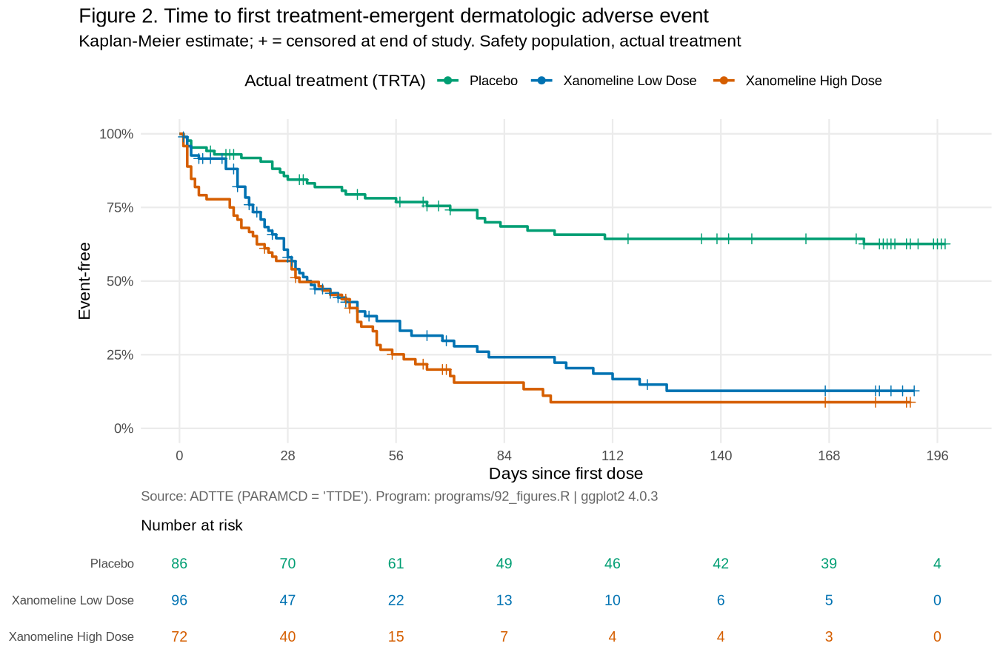

# adam-admiral-walkthrough

[](https://github.com/Ngarciar24/adam-admiral-walkthrough/actions/workflows/tests.yml)

ADaM datasets, define.xml and analysis outputs for the public CDISC pilot study (CDISCPILOT01), built in R with [{admiral}](https://pharmaverse.github.io/admiral/) and checked against the published pilot ADaM datasets.

**Read it online:** [the walkthrough site](https://ngarciar24.github.io/adam-admiral-walkthrough/) · [From ADaM to an HTA dossier](https://ngarciar24.github.io/adam-admiral-walkthrough/hta/) · [efficacy report](https://ngarciar24.github.io/adam-admiral-walkthrough/report.html) · [define.xml, rendered](https://ngarciar24.github.io/adam-admiral-walkthrough/data/adam/define.html) · [reviewer's guide](https://ngarciar24.github.io/adam-admiral-walkthrough/docs/adrg.html)

## What it does

- **Datasets.** Builds ADSL, ADLB (BDS), ADAE (OCCDS), ADTTE (time to first dermatologic event) and ADQSADAS (ADAS-Cog, with analysis windows and LOCF) from SDTM.
- **Transport files and define.xml.** Exports all five to SAS Transport v5 from one specification (`metadata/`). The same specification generates a Define-XML 2.1 `define.xml`, validated against the CDISC schema and against the transport files.
- **Comparison with the pilot.** Compares every dataset with the published CDISC pilot ADaM datasets, variable by variable. Each difference must be explained in `metadata/pilot_differences.csv` or the run stops.
- **Outputs.** Produces a demographics table, an ALT change-from-baseline table and figure, a time-to-event table with a Kaplan–Meier plot, and the primary efficacy ANCOVA.
- **From ADaM to an HTA dossier.** A self-study extension in `hta/`, in three chapters. Chapter 1 analyses the ADaM data the way a health technology assessment asks for it: Kaplan–Meier, stratified Cox, proportional-hazards checks, restricted mean survival time, death as a competing event, subgroup analyses with interaction tests, risk ratio, odds ratio and risk difference, and the standard adverse-event sets. Page 1b reads the efficacy endpoint as IQWiG does (Hedges' g, a responder analysis at 15% of the scale range) and puts all endpoints in one table in dossier layout. Page 1c fits six parametric survival models, extrapolates them and checks the extrapolations against later follow-up. Chapter 2 is a meta-analysis of 13 vaccine trials and of 65 cancer trials pooled on the hazard-ratio scale. Chapter 3 covers the Bucher indirect comparison, a network meta-analysis and population-adjusted methods. Each hand calculation is tested against an established R package.
- **Checks.**
  - 425 `testthat` expectations: 225 on the derivations, including unit tests of the baseline rule on hand-built data, and 200 on the HTA part, including checks that every hand calculation agrees with `{survival}`, `{survRM2}`, `{metafor}`, `{netmeta}` or `{flexsurv}` to within 1e-8, and that the subgroup function agrees with `{tern}`.
  - 71 ADaM conformance checks.
  - An independent Python re-derivation of the treatment-emergent flag and the time-to-event data.
- **Reproducibility.** GitHub Actions rebuilds everything on every push, in a pinned `{renv}` environment.

## Results

Primary efficacy analysis (`outputs/t4_adascog_wk24_ancova.txt`). The Ns, differences, confidence intervals and p-values equal the published pilot table, as reproduced in the [R Consortium submission pilot](https://rconsortium.github.io/submissions-pilot1/articles/tlf-primary.html):

```
Table 4. ADAS-Cog(11) Total Score: Change from Baseline to Week 24 (LOCF)
Efficacy Population (EFFFL = 'Y'); planned treatment (TRTP)
                                           Placebo      Xanomeline Low Dose   Xanomeline High Dose
                                            (N=79)            (N=81)                 (N=74)
Change from baseline, mean (SD)           2.5 (5.80)        2.0 (5.55)             1.5 (4.26)
LS mean change (SE)                       2.5 (0.60)        2.0 (0.59)             1.5 (0.62)
LS mean difference vs placebo (95% CI)                   -0.5 (-2.1, 1.1)       -1.0 (-2.7, 0.7)
Dose-response p-value                       0.245
```

Time to first treatment-emergent dermatologic adverse event (`outputs/f2_ttde_km.png`):



Comparison with the published pilot ADaM (`outputs/qc/pilot_comparison.txt`):

```
Items compared: 68; matching: 48; explained differences: 20; unexplained: 0
```

The remaining differences come from four documented decisions: actual treatment, imputation of year-only dates, the laboratory baseline rule, and LOCF bookkeeping. See [docs/adrg.md](docs/adrg.md#61-differences-from-the-published-pilot-analysis).

## Run it

```r
renv::restore()
source("run_all.R")
```

```sh
pip install pandas lxml odmlib==0.2.1
python3 python/check_adam.py        # independent re-derivation
python3 python/validate_define.py   # define.xml schema and consistency
python3 python/adam_conformance.py  # ADaM conformance checks
```

`run_all.R` rebuilds every dataset, the `.xpt` files, define.xml, the tables and figures, then compares with the pilot and runs the tests. It downloads SDTM QS and the pilot reference datasets from a pinned commit of `phuse-scripts` and verifies their checksums, so it needs network access.

## Report

`reports/adascog_ancova.qmd` is a Quarto report on the primary efficacy analysis. It reads `data/adam/adqsadas.xpt`, rebuilds Table 4 and stops if any cell differs from `outputs/t4_adascog_wk24_ancova.csv`. It also includes the full model output, residual and slope checks, and exploratory sensitivity analyses: observed cases, Week 24 completers and an MMRM. It needs only the committed transport file, so `run_all.R` does not have to run first.

```sh
quarto render reports/adascog_ancova.qmd   # writes reports/adascog_ancova.html
```

This needs the [Quarto CLI](https://quarto.org/docs/get-started/) and the `{renv}` library (`renv::restore()`). CI renders the report on every push and publishes it, with define.xml and the guides, at <https://ngarciar24.github.io/adam-admiral-walkthrough/> (`site/build_site.sh` assembles the site).

## From ADaM to an HTA dossier

`hta/` is a small Quarto website. It reads the committed transport files in `data/adam/` and data shipped with installed R packages (`{metadat}`, `{netmeta}`), so it downloads nothing and does not need `run_all.R` first.

```sh
quarto render hta   # writes hta/_site/
```

| Chapter | Data | Methods |
|---|---|---|
| 1. Time-to-event and safety analyses | ADSL, ADAE, ADTTE, ADQSADAS of CDISCPILOT01 | Kaplan–Meier, log-rank, Cox (unstratified and stratified), Schoenfeld residuals, RMST, Aalen–Johansen for death as a competing event, subgroups with interaction tests, RR/OR/RD, any, serious and severe AEs and discontinuations due to AEs |
| 1b. Efficacy as an assessment body reads it | ADQSADAS, ADSL, ADAE | Hedges' g against IQWiG's irrelevance threshold of 0.2, responder analysis at 15% of the scale range, one summary table in dossier layout |
| 1c. Parametric survival and extrapolation | 686 breast cancer patients (German Breast Cancer Study Group, `flexsurv::bc`) | Exponential, Weibull, Gompertz, log-logistic, log-normal and generalised gamma fitted to 3 years of follow-up, AIC and BIC, extrapolation checked against the later data, model hazards, following NICE DSU TSD 14 |
| 2. Meta-analysis | 13 BCG vaccine trials (Colditz et al. 1994, `metadat::dat.bcg`) and 65 head and neck cancer trials (Pignon et al. 2000, `metadat::dat.pignon2000`) | Inverse-variance and REML random effects with Hartung–Knapp, Q, I², τ², prediction interval, forest and funnel plots, leave-one-out, `rma.mv` as a mixed model, hazard ratios from O − E and V, Paule–Mandel with Knapp–Hartung as IQWiG runs it, test for subgroup differences |
| 3. Indirect treatment comparison | 24 smoking-cessation studies (Hasselblad 1998, `netmeta::smokingcessation`) | Bucher method, network meta-analysis, league table, node splitting, and a text page on MAIC and STC |

The hand calculations live in `R/hta_methods.R`. The chapters and `tests/testthat/test-hta-*.R` both use them. `R/hta_subgroups.R` returns the subgroup table and forest plot for any ADTTE parameter in one call. `R/hta_ae_tte.R` derives time to first event for each standard adverse-event set with `{admiral}`. Statements about IQWiG's methods quote its General Methods, version 7.0 of 19 September 2023, with section numbers. This part is self-study on public data and is not part of any regulatory or HTA submission.

## Layout

```
programs/00_setup.R            load SDTM and metadata
programs/01_adsl.R             ADSL
programs/02_adlb.R             ADLB (BDS)
programs/03_adae.R             ADAE (OCCDS)
programs/04_adtte.R            ADTTE (time to event)
programs/05_adqsadas.R         ADQSADAS (windows, LOCF)
programs/90_export_xpt.R       XPT export, spec coverage and round-trip checks
programs/91_tables.R           Tables 1-2 and a traceability trace
programs/92_figures.R          Figures 1-2
programs/93_tables_tte_eff.R   Tables 3-4 (time to event, ANCOVA)
programs/94_define.R           define.xml and define.html
programs/95_compare_pilot.R    comparison with the published pilot ADaM
reports/adascog_ancova.qmd     Quarto report: primary efficacy ANCOVA
hta/                           Quarto website: From ADaM to an HTA dossier
site/                          landing page and the script that assembles the Pages site
R/                             shared functions (baseline rule, pinned downloads, HTA hand calculations, subgroup function, AE-set time to event)
metadata/                      specification, codelists, windows, explained differences
tests/testthat/                tests
python/                        independent checks
outputs/                       tables, figures; outputs/qc/ holds the QC reports
data/adam/                     .xpt files, define.xml, define.html
docs/sap.md                    analysis rules
docs/adrg.md                   analysis data reviewer's guide
docs/implementation-notes.md   technical notes and checked facts
```

## Traceability

One value, followed from SDTM to a table cell (`outputs/t2_traceability_chain.txt`):

```
LB    01-701-1028  LBSEQ 135  ALT  WEEK 8  LBSTRESN 33
ADLB  01-701-1028  ASEQ 5     ALT  WEEK 8  AVAL 33  BASE 26  CHG 7
      BASE comes from the same subject's baseline row (ASEQ 1, ABLFL = Y, AVAL 26)
Table 2 / WEEK 8 / Mean CHG / Xanomeline High Dose
```

ADLB keeps `LBSEQ`, `VISIT` and `LBSTRESN`, ADAE keeps `AESEQ`, ADQSADAS keeps `QSSEQ`, and ADTTE records `SRCDOM`/`SRCVAR`/`SRCSEQ`. define.xml gives the origin and derivation of every variable.

## Scope

Portfolio project on public test data, not a regulatory submission. Real study work would add a protocol-specific SAP, validated double programming, laboratory visit windows and a complete set of efficacy and safety parameters. The pilot data carry no MedDRA codes and no protocol deviations.

## Licence

MIT. Source data belong to `{pharmaversesdtm}` and the CDISC pilot project (via `phuse-scripts`); they are downloaded at run time, not redistributed. The published trial results used in `hta/` come with the `{metadat}` and `{netmeta}` packages.

## How it was made

The whole repository was built with the help of Claude Code, an AI coding assistant. That covers the ADaM programs, the transport files and define.xml, the checks in R and Python, the efficacy report and the HTA part. I set the scope and reviewed the code and text. The evidence that the numbers are right lies in the repository itself: the variable-by-variable comparison with the published pilot ADaM datasets, the independent Python re-derivation, the ADaM conformance checks, and the test suite, where every hand calculation is checked against an established R package.
